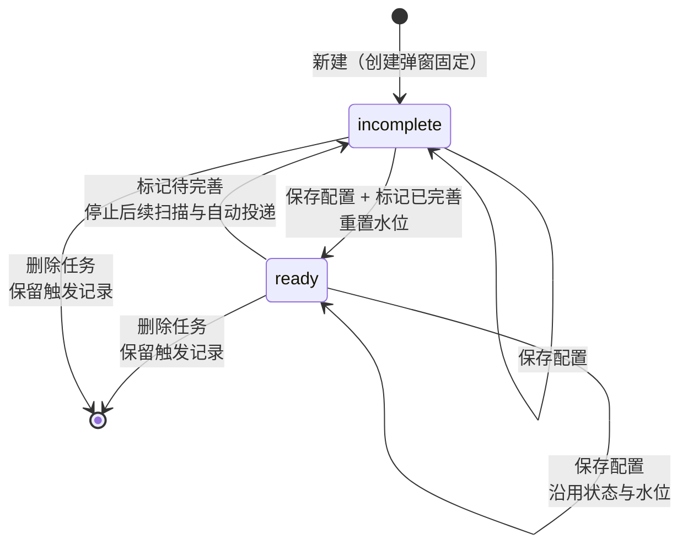
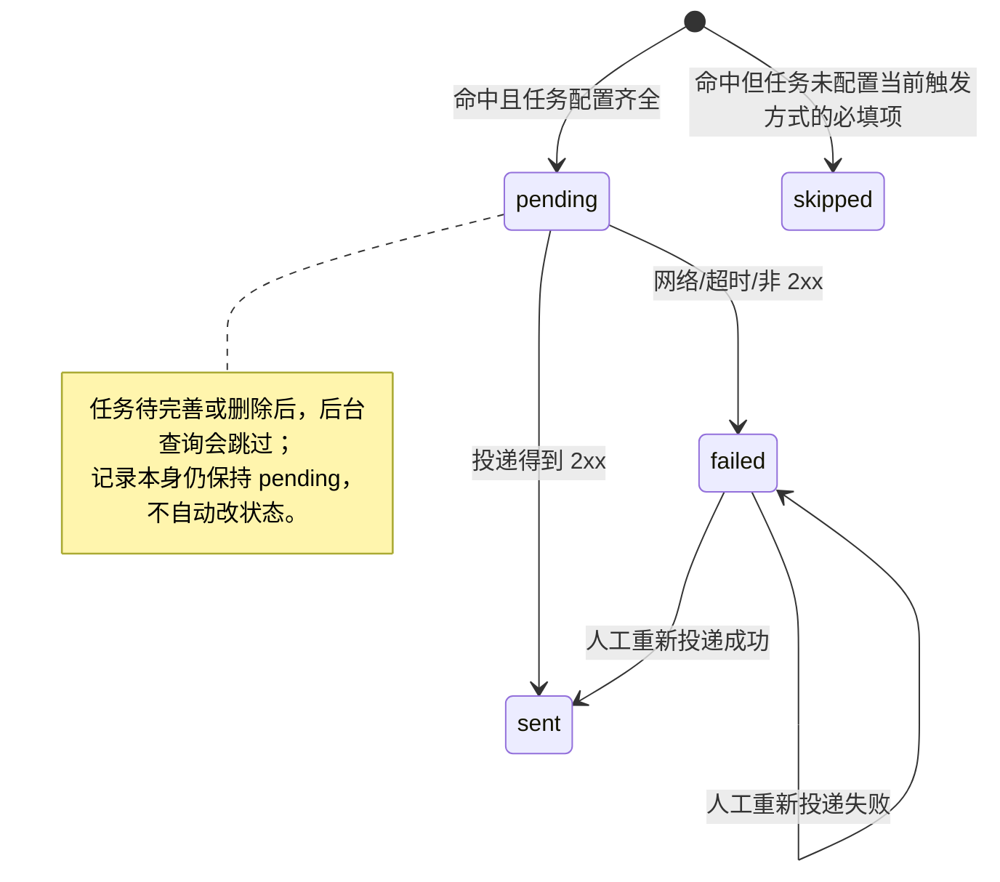

# 任务信息（关键词触发与多厂商触发方式）

这份文档写给维护【任务信息】面板的人：先说明它到底是什么，再按界面、状态机、扫描、
投递、存储、权限和现有测试逐层拆开。目标是让下一个人能在不把“待办日程”“聊天素材
收集任务”“定时总结任务”混进来的前提下改这一域。

> 入口：桌面侧栏「行动与维护 → 任务信息」（`taskinfo`）。核心实现在
> [`../src/backend/wechat-data/src/query/task-center.ts`](../src/backend/wechat-data/src/query/task-center.ts)，
> 面板在 [`../src/client/ui-wechat/src/client/pages/wechat-data/panels/TaskCenter.tsx`](../src/client/ui-wechat/src/client/pages/wechat-data/panels/TaskCenter.tsx)。
> 隐私与出网声明见 [`PRIVACY.md`](PRIVACY.md) §四 G3；Remote 方法签名见 [`API.md`](API.md)。
> 多 RPA 厂商（影刀/实在/来也/UiPath/阿里云等）的可选触发方案、逐家参数与调研见
> [`RPA-VENDOR-TRIGGERS.md`](RPA-VENDOR-TRIGGERS.md)（**2026-10-21 已落地**：内置 Webhook / 八爪鱼 +
> 影刀 / UiPath / 阿里云 / 来也 / 实在五家厂商，阿里云/来也/实在为实验性）。

---

## 1. 一句话理解

【任务信息】是一个**关键词触发的监听任务中心**：用户选定一个会话（群聊还要选定群内
某位成员）、一组关键词和**触发方式**；任务启用后，系统只检查该对象**新产生**的消息，命中
关键词就落一条触发记录，再按当前触发方式投递。触发方式来自**后端下发的目录**（默认
Webhook，其余为注册表里的 RPA 厂商，见 §3.5/§6）：内置 Webhook 把整条记录 POST 到你填的
地址；内置八爪鱼与新增的影刀 / UiPath / 阿里云 / 来也 / 实在则走同一条**通用出网管道**，
只发会话名 / 触发文本 / 触发对象三个映射参数。触发方式只决定「记录怎么投出去」，不改变
「任务由微信消息命中驱动」这一事实；任何方式都不能回扫历史。

它不是：

| 相邻功能 | 实际语义 | 与本域的关键区别 |
|---|---|---|
| 待办日程 | 从聊天文本里提取 TODO，供人查看/勾选 | 本域由用户**显式创建**，有触发对象、关键词和回调 |
| 聊天素材收集任务 | 创建时快照最近 N 条文本 + M 张图 | 本域不搬历史；只监听创建/启用之后的**新消息** |
| 定时总结任务 | 按时间生成总结，再交给模型 | 本域由**消息命中**驱动，不走模型、不生成总结 |

因此页面上的“任务”不是“下一步要做的事”，而是一条**监听规则 + 投递配置**。

## 2. 术语

| 术语 | 含义 | 代码位置 |
|---|---|---|
| 任务 / 任务信息 | 一条监听配置：会话、触发对象、关键词、@我限制、图片张数、**触发方式（method id）与对应配置 / 凭据**、状态 | `TaskInfo` |
| 会话 | 被监听的单聊对象或群；存 `chatUsername` 和创建时的显示名 `chatName` | `TaskInfo.chatUsername` |
| 触发对象 | 单聊里是对方；群聊里是所选的那位群成员 | `TaskInfo.targetUsername` |
| 触发记录 | 一条新消息命中关键词后留下的事实快照，独立于任务配置 | `TaskTriggerRecord` |
| 仅匹配@我的文本 | 群聊可选条件：只处理结构化 `atuserlist` 包含登录账号的消息；`notify@all` 不算 | `TaskInfo.mentionMeOnly` |
| 水位 | 每个任务已扫描到的消息 `sort_seq`，只存在于 `task_info.last_scan_seq`，不返回前端 | `query/task-center.ts` |
| 触发方式 | 记录投出去的方式，开放字符串：内置 `webhook` / `bazhuayu`，其余为注册表里的厂商 id（`yingdao` / `uipath` / `aliyun-rpa` / `laiye` / `shizai`）；旧库缺列按 `webhook` | `TaskTriggerMethod`（`types-taskcenter.ts`） |
| 触发方式目录 | 后端 `listRpaVendors` 下发的可序列化描述符列表 + 注册表版本；前端据此渲染选择器与动态表单，**不打包厂商清单** | `RpaVendorCatalog`（`types-rpa.ts`） |
| 厂商描述符 | 一家厂商的声明式描述：配置字段、鉴权、参数映射、请求模板、响应解析、完成能力、出网主机白名单、来源与风险 | `RpaVendorDescriptor` |
| 注册表 | 显式 import 各厂商适配器并按 UI 顺序排列的数组；派发时按 `triggerMethod` 查表，未知/下线 → skipped | `query/rpa/registry.ts` |
| 触发配置 | 非敏感配置 JSON（URL / FlowId / ReleaseKey / 参数映射…），存在 `task_info.trigger_config`，随任务列表返回 | `TaskInfo.triggerConfig` |
| 触发凭据 | 敏感配置 JSON（API Key / AccessKey / PAT / 令牌…），存在 `task_info.trigger_secret`，**只回 `triggerSecretSet` 布尔**，永不回读原文 | `TaskInfo.triggerSecretSet` |
| 内置 Webhook | 触发方式之一：把一条触发记录以 JSON POST 到该任务配置的地址（含图片） | `query/rpa/vendors/webhook.ts` |
| 内置八爪鱼 RPA | 触发方式之一（v23 新增，v24 起为「内置厂商之一」）：POST 到固定主机 `api-rpa.bazhuayu.com` 的启动流程接口，用任务里配的 FlowId + API Key，**不发图片** | `query/rpa/vendors/bazhuayu.ts` |
| 通用派发管道 | 与厂商无关的「校验 → 隐私闸 → 渲染 → 鉴权 → 发送 → 解析 → 落状态」；本域**唯一**出网函数 `sendRequest` 在 `query/rpa/dispatch.ts` | `query/rpa/dispatch.ts` |
| 已完善 | 可参与扫描与投递；必须有关键词 + **当前触发方式**的必填配置/凭据齐全（`missingReadyFields` 为空），群聊还必须选目标成员 | `TaskInfoStatus = 'ready'` |
| 待完善 | 只保存配置，不扫描、不投递 | `TaskInfoStatus = 'incomplete'` |

## 3. 入口与界面结构

### 3.1 创建入口

创建动作不在任务信息面板内，而是在聊天侧统一打开
[`../src/client/ui-wechat/src/client/pages/wechat-data/panels/task-create-dialog.tsx`](../src/client/ui-wechat/src/client/pages/wechat-data/panels/task-create-dialog.tsx)：

1. 会话头部「更多 → 新建任务」；
2. 群信息抽屉底部「新建任务」；
3. 单聊聊天信息抽屉底部「新建任务」。

弹窗里选择会话、关键词、照片数量（0–9）和可选任务名；群聊再选一个目标成员，并可勾选
「仅匹配@我的文本」。创建结果固定为**待完善**，这里不填投递配置（Webhook 地址或某个 RPA
厂商的账号/凭据/参数都由任务信息页的**编辑抽屉**负责），因此
“新建完还要去任务信息里启用”是设计路径，不是漏了一步。

### 3.2 面板两栏与编辑抽屉

桌面端打开「任务信息」后是 3:7 的双栏；小于 900px 时上下堆叠。两栏各自滚动，页头
和工具栏不随记录列表滚走。点任务行的「编辑」从**右侧滑出编辑抽屉**（不再在行内展开表单），
抽屉由 `TaskCenterView` 根部渲染一次（kit `Drawer`，`role="dialog"`），标题是
「编辑任务 · <任务名>」；关闭按钮、遮罩与 Esc 都能关掉它，任务被删 / 刷新后不存在时抽屉自动关闭。

| 区域 | 内容与交互 |
|---|---|
| 页头 | 标题、功能说明、「刷新」「立即检查」；立即检查有二次确认 |
| 工具行 | 左侧提示“点任务可筛右栏”，右侧任务状态计数与当前记录总数 |
| 左栏 · 任务列表 | 任务搜索框、批量选择入口、任务名、状态徽标、会话/目标、触发次数、最近触发时间、关键词、图片张数、**触发方式摘要**（厂商名 + 描述符里 `summary` 的字段，如 Webhook 主机 / 八爪鱼 FlowId / 影刀应用 UUID）、编辑（打开右侧抽屉）/删除 |
| 右栏 · 触发记录 | 触发记录搜索框、批量选择入口、时间、任务名、回调状态、会话/目标、命中关键词、图片数、文本摘要、加载更多 |
| 记录弹窗 | 完整文本、按需解码的图片、回调状态/时间/错误、「重新投递」 |
| 编辑抽屉 | 任务名 / 触发关键词 / **触发方式**（来自 `listRpaVendors` 目录）/ 照片数量 / 触发方式对应的动态配置（按描述符分组：账号与鉴权 / 流程与参数 / 高级）/ 仅匹配@我的文本 / 动作区（保存、标记已完善、删除、状态说明） |

几个容易误解的交互：

- 点任务行会把右栏筛到该任务；点「编辑」打开右侧编辑抽屉（不改变右栏筛选），关闭抽屉
  不会丢已经保存的配置。
- 右栏记录行只放摘要；完整文本和图片只在记录弹窗里出现。
- 左栏搜索只过滤**已完整加载的任务列表**，匹配任务名、关键词、会话/对象名及其 username，
  以及通用触发配置里的字符串值（Webhook 地址 / FlowId / 应用 UUID 等，全部 flatten）；
  右栏搜索是**服务端搜索**，匹配正文、任务名、会话/对象、关键词及投递错误，
  因此能命中尚未加载到当前页的历史记录。
- 两个搜索框都保留原文作为受控值；右栏在停止输入 250ms 后提交查询，前后端统一最多使用
  100 字。清除按钮清空搜索并回到该栏未筛选状态。

### 3.3 删除入口

任务行与编辑抽屉里的表单共用 `task-delete-button.tsx`，保证两处使用同一套危险色、二次确认、
桌面端降级和失败提示。确认框明确说明：**删除的是任务配置，已经产生的触发记录会保留**。
删除成功后容器会等待任务与触发记录两栏回源，再显示成功提示；历史记录仍可在右栏查看，
但所属任务不存在后，pending/failed 记录不能再重新投递。

### 3.4 批量删除

左右两栏各自有「批量 / 退出批量」入口，互不联动。进入批量后：

1. 行尾的单条编辑/删除入口收起，行本身与复选控件都用于切换选择；
2. 栏头下方出现「全选 / 清空 / 已选 N 条 / 删除所选 (N)」操作条；
3. 「全选」只覆盖当前可见行：左栏受任务搜索过滤，右栏受任务筛选与服务端搜索过滤；
4. 切换搜索条件、切换左栏任务筛选、退出批量或刷新后已不存在的 id，都会清理选择，
   避免把当前屏幕看不到的数据带进删除请求；
5. 一次最多提交 500 个去重后的 id；超过上限时整单拒绝并提示分批操作，不会只删前 500 条。

任务批量删除与单条删除语义相同：**只删除任务配置，关联触发记录仍保留**。确认框会明确
说明历史记录仍可在右栏回看。删除后若当前选中任务、正在编辑的任务或记录弹窗指向已删数据，
容器会清理对应状态，并等待任务、触发记录两栏回源后再显示成功提示。

触发记录批量删除确认框会说明三件事：删除不可恢复、不会删除微信里的原始消息、所属任务的
触发次数与最近触发时间会按剩余记录重算。后端删除记录与重算任务统计在同一个事务中完成；
任一步失败都会整体回滚，避免留下「记录已删、统计仍旧」的半完成状态。

### 3.5 编辑抽屉与触发方式

[`../src/client/ui-wechat/src/client/pages/wechat-data/panels/task-center-edit-form.tsx`](../src/client/ui-wechat/src/client/pages/wechat-data/panels/task-center-edit-form.tsx)
是抽屉里的表单本体；抽屉外壳与 `TaskEditForm` 的渲染在
[`../src/client/ui-wechat/src/client/pages/wechat-data/panels/TaskCenter.tsx`](../src/client/ui-wechat/src/client/pages/wechat-data/panels/TaskCenter.tsx)
（`TaskCenterView` 根部渲染一次），行上的「编辑」按钮在
[`../src/client/ui-wechat/src/client/pages/wechat-data/panels/task-center-panes.tsx`](../src/client/ui-wechat/src/client/pages/wechat-data/panels/task-center-panes.tsx)
的 `TaskRow`。
表单在抽屉里是**单列分区**：任务名 / 触发关键词 / 触发方式 / 照片数量 / 触发方式对应配置 /
仅匹配@我的文本（群聊才显示）/ 动作区。表单保留 `aria-label="编辑任务：<任务名>"`，
SSR 与 E2E 选择器依赖它。会话与触发对象在这一版不提供换绑入口。

**触发方式**（`aria-label="触发方式"`）—— 选项由后端下发的 `listRpaVendors` 目录渲染
（`<select>` 或 kit Select；选项 = `descriptor.name`），**默认 Webhook**；任务当前的 method
不在目录里时显示「触发方式不可用（厂商已下线）」并禁止保存。目录当前包含：

- **内置**：`Webhook`、`八爪鱼 RPA`（v23 新增，v24 起为内置厂商之一）；
- **新增厂商**：影刀 RPA、UiPath Orchestrator、阿里云 RPA（实验性）、来也 RPA（实验性）、
  实在智能 RPA（实验性）。

选中厂商后按 `descriptor.fields` **动态渲染**：

- 分三组：secret / 账号类字段 →「账号与鉴权」；流程与参数映射字段 →「流程与参数」；
  `advanced` 字段 →「高级」（默认折叠，如私有化实例地址、回调地址）。
- 控件按 `type`：text / number / select / boolean；`secret` 用密码框且**永不回显**，已配置时
  placeholder 为「已保存，留空保持不变」（界面只从 `triggerSecretSet` 知道「配置过」）；
  `map` 字段渲染 3 个输入（会话名 / 触发文本 / 触发对象，默认 key 来自
  `descriptor.mapping.targets`，标签见 `target.label`）。
- `paramList` 字段（如八爪鱼「附加参数」）渲染为**可增删的参数列表**：每行 = 参数名输入 +
  「值来源」下拉（`field.paramSources` 子集，缺省 11 种：会话名 / 触发文本 / 触发对象 /
  任务名 / 触发关键词 / 触发时间 / 会话类型 / 任务 id / 触发记录 id / 固定值 / 自定义模板）+
  按来源显示的「固定值」输入或「自定义模板」输入（模板只允许 `${record.<白名单字段>}` /
  `${task.name}` / `${task.id}`，模板框旁给白名单提示）；支持「添加 / 删除」（列表顺序即
  请求里的参数顺序），最多 `field.maxItems` 条（八爪鱼 = 20），超过时禁用「添加」；参数名
  不得与三个映射键重名、同一列表内不得重名（保存 / 标记已完善时报错并定位到该行）。
- 每个输入 `aria-label = field.ariaLabel ?? field.label`（E2E / SSR 依赖）；`example` 作 placeholder。
- 厂商说明区：厂商名 + 状态徽标（实验性 → ⚠ 实验性）+ 一句话简介 + 官方文档链接 +
  「参数核对 2026-10-21」+ 风险前 2 条（小字）。
- 任务的 `triggerVendorVersion` 与当前目录不一致时，顶部提示「厂商参数已更新，请复核后再保存」，
  **不静默改配置**。
- 保存时 `triggerConfig` 全量带当前方式的配置，`triggerSecret` 只带本次填写的非空凭据
  （留空 = 保留旧值，`''` = 清空）。切换触发方式后保存会**替换非敏感配置**（以当前方式为准）；
  凭据按 `triggerSecret` 逐键保留/覆盖，不会因为切换方式被自动删除。
- 「标记已完善」的前置条件按**当前方式**判定（前后端同一份描述符：`missingReadyFields` 为空），
  缺哪项就报对应字段的错误并把焦点移过去。

任务行摘要：内置 Webhook 显示 `Webhook <host>` / 未填时 `未填 Webhook`；内置八爪鱼显示
`八爪鱼 RPA · <flowId>` / 未填 FlowId 时 `八爪鱼 RPA · 未填 FlowId`；其它厂商显示
`<厂商名> · <summary 字段值>`（如影刀显示应用 UUID）。

动作区：

- 「保存」写配置，保留当前任务状态。
- 「标记已完善」是**先保存配置、再改状态**的两次写入。第一次失败就停在原状态；第二次
  失败时配置可能已经保存，但任务仍是待完善。缺当前方式的必填项时整单拒绝，并把焦点移到
  对应字段（由 `missingReadyFields` 给出的字段列表）。
- 「标记待完善」可逆，只改状态；已产生的触发记录保留。
- 「删除」有二次确认；任务配置删除，触发记录刻意保留。

## 4. 创建到投递的完整流程

```mermaid
flowchart TD
    A[聊天侧新建任务] --> B[写入 task_info<br/>status=incomplete<br/>初始化 last_scan_seq]
    B --> C[打开任务信息<br/>在右侧抽屉补触发方式配置]
    C --> D{保存并标记已完善?}
    D -- 否 --> C
    D -- 是 --> E[先 save 配置<br/>再 setStatus ready]
    E --> F[把水位重置为该会话当前最大 sort_seq]
    F --> G[实时同步或 10s 兜底触发扫描]
    G --> H{新消息来自触发对象<br/>且通过@我限制<br/>且正文包含关键词?}
    H -- 否 --> G
    H -- 是 --> I[INSERT OR IGNORE 一条触发记录<br/>图片只存引用]
    I --> J[立即广播 task-center/updated]
    J --> K[后台单飞投递 pending 记录]
    K --> L{任务仍 ready<br/>且当前触发方式配置齐全?}
    L -- 否 --> M[skipped，等待人工处理]
    L -- 是 --> N[隐私闸处理触发文本]
    N --> O{触发方式?}
    O -- 内置 Webhook --> P[按需解码图片<br/>POST 整条记录 JSON]
    O -- RPA 厂商 --> Q[按描述符渲染请求 + 鉴权<br/>只发三个映射参数，不发图片]
    P --> R{HTTP / 业务码成功?}
    Q --> R
    R -- 是 --> S[sent<br/>external_task_id 落库]
    R -- 否 --> T[failed<br/>人工重新投递]
```

投递分支的判定顺序：先看任务是否仍「已完善」且**当前触发方式**的必填配置/凭据齐全
（由 `missingReadyFields` 判定；未知/已下线厂商直接 skipped），再看触发方式 —— 内置 Webhook
会把整条记录（含按需解码的图片）以 JSON POST 出去；**RPA 厂商**走同一条通用管道，只把
三个语义参数（会话名 / 触发文本 / 触发对象）按描述符的映射规则装进该厂商的请求，
**不解码图片**。所有方式都由同一个隐私闸处理触发文本；失败都只记状态、可人工重新投递。
`sent` 只代表厂商已受理（v1 不接收厂商回调、不轮询完成状态）。

### 4.1 水位为什么必须初始化

如果新建任务时水位为 0，下一次扫描会把该会话的全部历史消息当成“新消息”，可能一次
生成几百条记录并向外部地址发送几百次请求。所以：

- 新建任务时，水位初始化成该会话当前最大 `sort_seq`；
- 从待完善变已完善时，再次用“当前最大”初始化；
- 已完善任务换会话时，也必须按新会话重置。

代价是：**任务创建/启用之前的消息不会被补触发**。面板没有“回扫历史”的入口。

### 4.2 扫描判定顺序

每个已完善任务独立扫描：

1. 只取 `sort_seq > last_scan_seq` 的消息，每页 200 条、最多 5 页；
2. 先判触发对象：单聊只认对方（`isSender === 0`）；群聊只认配置的目标成员；
3. 若群聊任务勾选「仅匹配@我的文本」，要求消息的结构化 `atuserlist` 精确包含登录 wxid；
   正文里的普通 `@昵称` 不参与判断，`notify@all` 也不算 @ 我；
4. 再取可读正文，trim 后为空则跳过；
5. 按用户配置顺序找第一个命中的关键词，做**大小写不敏感的包含匹配**；
6. 一条消息最多生成一条记录，记录里保留第一个命中的关键词原文；
7. 触发文本最多保存 4,000 字；触发时间取消息时间，缺失时退回落库时间；
8. 图片按目标对象的“最近 N 张”收集引用，时间正序；扫描阶段不解码；
9. 水位只在确实见过更大的 `sort_seq` 时推进，空扫描不写库。

去重有两层：水位防止同一段消息被重复扫描；`UNIQUE(task_id, message_local_id)` 配合
`INSERT OR IGNORE` 防止同一任务对同一消息重复落记录。

因此，同一会话里先后发送两次相同文本（例如两条「你好」）会生成两条记录，只要它们
确实是两条不同的消息；反过来，同一条消息无论被扫描多少次都只保留一条。去重键是
消息身份，不是文本内容。

### 4.3 扫描的触发时机

关键词触发是常驻能力，不要求面板处于打开状态：

- **主路径**：实时同步回调发现新分片落地后，立即安排一拍扫描；
- **兜底**：每 10 秒（`SYNC_INTERVAL_MS`）一次定时扫描；
- **手动**：「立即检查」走同一个扫描调度器，并额外等待一批投递完成，以便如实回报
  投递条数。

扫描与投递是两条独立的单飞（single-flight）链路。扫描记录落库后会先广播
`task-center/updated`，再在后台开始投递；慢回调不会堵住下一拍扫描。并发请求只会合并成
一次补跑，不会并发打开同一个任务库。

## 5. 状态机

### 5.1 任务状态



`ready` 不是“永久启用”：任务被退回待完善后，已有记录不再进入后台批量投递；但右栏仍能
查看它们。删除任务后，记录同样保留，但所属任务已不存在。

### 5.2 回调状态



四种状态的中文口径：

| 状态 | 界面文案 | 含义 |
|---|---|---|
| `pending` | 待投递 | 生成时配置齐全，等待后台或人工投递 |
| `sent` | 已投递 | 已收到 2xx |
| `failed` | 投递失败 | 请求已尝试，但失败原因已落库 |
| `skipped` | 未配置 | 记录生成时任务没有当前触发方式的必填配置/凭据（或该厂商未知/已下线） |

`skipped` 不会因为后来补上配置而自动转成 `pending`；后台批量投递只捞 `pending`。

## 6. 投递协议（多厂商）

### 6.1 通用派发管道（除内置 Webhook 外的所有厂商都走这里）

- **注册表解析**：`triggerMethod` → `RpaVendorAdapter`；未知 / 已下线厂商 → skipped（可读原因），
  一个请求都不发。
- **配置校验**：描述符 `fields` 的必填 / pattern / select / number 校验 + secret 是否已配置
  （`missingReadyFields`）；不齐 → skipped。
- **请求组装**：`buildRequest?.(ctx, deps) ?? renderRequest(descriptor, ctx)`；模板占位符只允许
  `config` / `secret` / `record` / `invocation` / `mapped` 五个根，只做字符串插值或整值替换
  （**禁止 eval / 任意表达式**，未知占位符报可读错误）。
- **鉴权**：`query/rpa/auth.ts` 按 `auth.modes` 选择 bearer / header / token-exchange / custom；
  影刀、UiPath OAuth 走 token-exchange（按「厂商 id + baseUrl + 凭据指纹」缓存 token），
  阿里云走 custom 钩子做 HMAC-SHA1 RPC 签名。
- **发送**：**本域唯一出网函数** `query/rpa/dispatch.ts#sendRequest` —— `fetchWithRetry`，单次 15 秒超时，
  attempts / retryOn 来自描述符；**无幂等键的厂商 `maxAttempts=1`（不自动重试）**，影刀用
  `idempotentUuid`、阿里云用 `X-Idempotent-Request-ID` 时才允许按策略重试。
- **主机校验**：请求 URL 的 host 必须命中描述符 `governance.hosts`（exact / suffix）；
  `allowCustomBaseUrl` 的厂商（UiPath / 来也 / 私有化实例）允许等于 `config.baseUrl` 的 host，
  但**禁止 localhost / 127.0.0.1 / 私网 IPv4 字面量**；内置 Webhook 只允许用户填写的 http(s)。
- **响应解析**：`parseResponse?.(...) ?? 通用解析`（HTTP 状态 + `okPath`/`okValue` +
  `externalTaskIdPath`）；HTTP 2xx 但业务码失败 → failed；成功时把厂商任务 id 落到
  `external_task_id`。
- **v1 不做**回调接收端与完成状态轮询：`sent` 只代表**厂商已受理**，执行结果需到厂商控制台查看。

### 6.2 内置 Webhook（触发方式 = `webhook`）

请求体由 `query/rpa/vendors/webhook.ts` 的 `buildRequest` 钩子构造，字段与旧版**逐字节一致**。

- 方法：`POST`
- 头：`content-type: application/json`
- 超时：单次 15 秒
- 重试：最多尝试 2 次（含首次，即最多 1 次重试）；只有 HTTP
  `408 / 429 / 500 / 502 / 503 / 504` 与网络/超时错误会重试
- 成功判定：HTTP 2xx

请求体形状来自 `TaskCallbackPayload`。示例（图片用省略号表示）：

```json
{
  "taskId": 12,
  "taskName": "项目群 · 小王 · 报价",
  "recordId": 87,
  "triggeredAt": 1760926983000,
  "triggeredAtText": "2026/10/20 09:03:03",
  "chat": {
    "username": "123456@chatroom",
    "name": "项目群",
    "type": "group"
  },
  "target": {
    "username": "wxid_target",
    "name": "小王"
  },
  "keyword": "报价",
  "text": "王工，最新报价请今天发我",
  "images": [
    {
      "localId": 456,
      "createTime": 1760926900000,
      "sender": "小王",
      "md5": "0123456789abcdef0123456789abcdef",
      "dataUrl": "data:image/jpeg;base64,..."
    }
  ]
}
```

图片解码在投递时进行。单张超过约 8,000,000 字符的 data URL、解码失败或路径不安全时，
该张图片省略并带 `error`，不会让整条回调失败。

### 6.3 内置八爪鱼 RPA（触发方式 = `bazhuayu`，v23 起；v25 参数增强）

它现在是注册表里的**内置厂商之一**（`query/rpa/vendors/bazhuayu.ts`，descriptor version `1.1.0`）：
固定主机 + `X-Api-Key`。**不配置参数映射 / 附加参数时，请求体与 v23 逐字节一致**（S0 回归基线）。

- 方法：`POST`
- 地址：`https://api-rpa.bazhuayu.com/api/bots/scheduling/start`（**固定主机**，不可改）
- 头：`content-type: application/json` + `X-Api-Key: <该任务保存的八爪鱼 API Key>`
- 超时 / 重试：单次 15 秒、最多尝试 2 次；非 2xx / 业务失败 → failed，原因写进
  触发记录的 `callback_error`
- **不含图片**：RPA 接口没有图片参数，触发记录里的图片引用不会解码、也不会发送

请求体形状沿用 `TaskBazhuayuStartPayload`，示例（未配置参数映射 / 附加参数时）：

```json
{
  "FlowId": "6ad859ccee2df270d53fc6e5",
  "FlowContentRetrievalMode": "ByNewestContent",
  "SpecifiedPublicationVersion": "",
  "SpecifiedBot": "",
  "Params": {
    "room_name": "项目群",
    "content": "王工，最新报价请今天发我",
    "at_name": "小王"
  },
  "UserStartSource": "OpenApi"
}
```

固定字段映射：`FlowId` 来自任务配置的「FlowId」；`FlowContentRetrievalMode` 固定
`ByNewestContent`；`SpecifiedPublicationVersion` / `SpecifiedBot` 固定空串；
`UserStartSource` 固定 `OpenApi`。

#### 6.3.1 参数映射（三个内置参数可改名，v25）

| 语义参数 | 默认参数名 | 取值（仍由系统决定） |
|---|---|---|
| 会话名 | `room_name` | 触发记录的会话显示名 `chatName` |
| 触发文本 | `content` | 触发文本（上限 4,000 字；过隐私闸后发送） |
| 触发对象 | `at_name` | 群聊 = 目标成员 `targetName`；**单聊没有独立目标名 → 回落会话名 `chatName`** |

`paramMap` 是 `map` 配置字段（默认 `{room: 'room_name', content: 'content', at: 'at_name'}`），
只改这三个键的名字、不改取值来源；保存后落在 `trigger_config.paramMap`。

#### 6.3.2 附加参数（`extraParams`，可选，最多 20 条）

描述符声明 `mapping.extrasField='extraParams'`；通用管道在三个语义参数**之后**把
`trigger_config.extraParams` 逐条解析并追加进同一个参数容器（`object` 形态 → `Params`
对象的额外键，数组 / form 形态同理追加）。条目结构 `{ name, source, fixedValue?, template? }`；
`name` 在同一列表内唯一，且**不得与三个映射键重名**（保存 / 标记已完善时报错）。

值来源（11 种）与解析规则：

| `source` | 界面名称 | 解析为 |
|---|---|---|
| `room` | 会话名 | 触发记录的会话显示名 |
| `content` | 触发文本 | 已过隐私闸的触发文本 |
| `at` | 触发对象 | 目标成员显示名；单聊回落会话名 |
| `taskName` | 任务名 | 任务当前名称 |
| `keyword` | 触发关键词 | 命中的关键词原文 |
| `triggeredAt` | 触发时间 | 本地时间文本（`zh-CN` 24 小时制） |
| `chatType` | 会话类型 | `群聊` / `单聊` |
| `taskId` | 任务 id | 十进制字符串 |
| `recordId` | 触发记录 id | 十进制字符串 |
| `fixed` | 固定值 | `fixedValue` 原文（≤2048 字） |
| `template` | 自定义模板 | 渲染后的字符串（≤512 字） |

**自定义模板白名单**（只允许下列 `${...}`；其余在保存时报错）：
`${record.chatName}`、`${record.targetName}`、`${record.targetUsername}`、`${record.username}`、
`${record.keyword}`、`${record.text}`、`${record.chatType}`、`${record.triggeredAt}`、
`${task.name}`、`${task.id}`。**不允许 `${secret.*}` / `${config.*}` 或白名单外字段**；
模板只做字符串插值 / 整值替换，不执行表达式。

校验与上限：参数名 ≤64 字、同一列表唯一、不得与三个映射键重名；固定值 ≤2048 字；
模板 ≤512 字；附加参数 ≤`maxItems`（八爪鱼 = 20，通用缺省 50）；空列表合法。

请求体示例（`paramMap` 改成 `room/content/at`，并追加两条参数：`keyword` 来源 +
`summary` 自定义模板 `${record.chatName} / ${record.keyword} / ${record.triggeredAt}`）：

```json
{
  "FlowId": "6ad859ccee2df270d53fc6e5",
  "FlowContentRetrievalMode": "ByNewestContent",
  "SpecifiedPublicationVersion": "",
  "SpecifiedBot": "",
  "Params": {
    "room": "项目群",
    "content": "王工，最新报价请今天发我",
    "at": "小王",
    "keyword": "报价",
    "summary": "项目群 / 报价 / 2026/10/20 09:03:03"
  },
  "UserStartSource": "OpenApi"
}
```

> 该机制通用：其他厂商后续只需在描述符里声明 `mapping.extrasField`（指向一个
> `type: 'paramList'` 字段）即可复用，核心管道不用改。

### 6.4 厂商目录（`listRpaVendors`）与逐家请求

下拉选项与动态表单完全来自后端目录；逐家参数表、官方文档入口、来源与风险见
[`RPA-VENDOR-TRIGGERS.md`](RPA-VENDOR-TRIGGERS.md) §3（参数核对时间 2026-10-21）。

| id | 名称 | 状态 | 触发主机 | 请求要点 | 凭据（secret） | 图片 |
|---|---|---|---|---|---|---|
| `webhook` | 内置 Webhook | stable | 用户填写的 http(s) 地址 | 整条记录 JSON | 无 | ✅ 含图片 |
| `bazhuayu` | 八爪鱼 RPA | stable | `api-rpa.bazhuayu.com` | `FlowId` + `Params` 三键（可改名）+ 可选附加参数（≤20 条）+ `X-Api-Key` | `apiKey` | ❌ 不发 |
| `yingdao` | 影刀 RPA | stable | `api.yingdao.com`（专有云用实例地址） | 先换 token，再 `POST /oapi/dispatch/v2/job/start`；`idempotentUuid` + `params[]` | `accessKeyId` / `accessKeySecret` | ❌ 不发 |
| `uipath` | UiPath Orchestrator | stable | `cloud.uipath.com`（`*.uipath.com` / `*.uipath.us`）或实例地址 | `POST …/odata/Jobs/…StartJobs`；PAT 或 OAuth（token-exchange）；`startInfo.InputArguments` 为 JSON 字符串 | `pat` 或 `clientId` / `clientSecret` | ❌ 不发 |
| `aliyun-rpa` | 阿里云 RPA | **实验性** | `console-rpa.aliyun.com`（线下部署用实例地址） | HMAC-SHA1 RPC 签名（custom）；服务型 `CreateTask` / 本地型 `createServiceTask` | `accessKeyId` / `accessKeySecret` | ❌ 不发 |
| `laiye` | 来也 RPA | **实验性** | `*.laiye.com` 或你配置的 Commander 实例地址 | MCP JSON-RPC：`POST {baseUrl}/automation/mcp`，`tools/call create_task` | `token` | ❌ 不发 |
| `shizai` | 实在智能 RPA | **实验性** | `z-commander-api.ai-indeed.com`（私有化用实例地址） | `POST /openAPI/v2/job/operation`；`jobUuid` / `operation` / `inputParam`；`retry.maxAttempts=1` | `appKey` / `appSecret` | ❌ 不发 |

> 实验性厂商（阿里云 / 来也 / 实在）的官方契约存在缺口（阿里云签名位置、来也 OpenAPI 文档未公开、
> 实在鉴权 header 名未公开），参数待联调；UI 会显示 ⚠ 与风险说明，未取得官方原文的字段不编造。

### 6.5 文本隐私闸

所有触发方式投递前都会以功能名 `task_callback` 调用同一个隐私闸：

- 开启「敏感字段打码」时，只对**触发文本**做脱敏；
- 同时写一条本机 AI 出站审计（字符数 / 会话数 / 消息数）。

当前不会对任务名、会话名、目标名、wxid、关键词、流程标识或图片内容做脱敏。

## 7. 数据模型与存储

数据库文件是 `<数据根>/wechat_task_center.db`，与 `wechat_tasks.db` 同级。两张表：

| 表 | 作用 | 关键列 |
|---|---|---|
| `task_info` | 任务配置与扫描状态 | `keywords`（JSON）、`photo_limit`、`mention_me_only`、`trigger_method`、`trigger_config`（非敏感 JSON）、`trigger_secret`（敏感 JSON）、`trigger_vendor_version`、`status`、`last_scan_seq`、`trigger_count`；兼容期另有 `callback_url` / `bazhuayu_flow_id` / `bazhuayu_api_key` |
| `task_triggers` | 触发事实与投递状态 | 任务/会话/目标的快照、`text`、`images`（JSON 引用）、`message_local_id`、`callback_status`、`callback_error`、`external_task_id` |

`task_info.last_scan_seq` 是内部字段，不进入前端契约。`task_triggers.task_name` 等快照
字段保证任务改名或删除后，历史记录仍可读。

`mention_me_only` 为 `0/1`，只对群聊有意义；单聊即使调用方传入 `mentionMeOnly: true`，
后端也会归一为 `false`。老库由 `ensureTaskSchema()` 通过 `PRAGMA table_info` 检查后执行
`ALTER TABLE` 自动补列，旧行默认 `0`。

v24（2026-10-21，多厂商）新增四列：

- `trigger_method TEXT NOT NULL DEFAULT 'webhook'`：开放字符串 —— 内置 `webhook` / `bazhuayu`，
  或注册表里的厂商 id；旧库缺列 / 无法识别的值按 `webhook` 归一；
- `trigger_config TEXT NOT NULL DEFAULT '{}'`：非敏感配置 JSON（键 = 描述符字段 key，含已填默认值）。
  八爪鱼在其中的结构：`flowId`（string）、`paramMap`（`{ room, content, at }` 三个参数名映射）、
  `extraParams`（**附加参数数组** `Array<{ name: string; source: string; fixedValue?: string; template?: string }>`，
  `source` 为 §6.3.2 的 11 种值来源之一；非敏感，随任务列表返回；上限由描述符
  `maxItems` 决定，八爪鱼 = 20，通用缺省 50）；
- `trigger_secret TEXT NOT NULL DEFAULT '{}'`：敏感配置 JSON（键 = secret 字段 key）。
  **任何公开快照都不返回原文**：`TaskInfo` 只回 `triggerSecretSet`（键 → 是否已配置），
  列表与编辑表单都拿不到凭据本身，投递时由后端读出使用。凭据以明文存在本机 SQLite 里，
  保护方式与任务库其它内容一致（数据根与目录权限），没有额外加密；
- `trigger_vendor_version TEXT NOT NULL DEFAULT ''`：保存时的 `descriptor.version`；与当前
  注册表不一致时 UI 提示「厂商参数已更新，请复核」；
- `task_triggers.external_task_id TEXT NOT NULL DEFAULT ''`：厂商返回的任务 id（供后续轮询；v1 只落库）。

**迁移与兼容**：`rowToTask` 若通用列空而旧列有值 → 迁移（webhook：`{url: callback_url}`；
bazhuayu：`{flowId: bazhuayu_flow_id}` + secret `{apiKey}`），并派生兼容别名 `callbackUrl` /
`bazhuayuFlowId` / `bazhuayuApiKeySet`；`saveTaskInfo` 归一入参（新字段优先，旧字段
`callbackUrl` / `bazhuayuFlowId` / `bazhuayuApiKey` 合并进通用配置）、按描述符补默认值、
写通用列并**双写**旧列，保证降级可读。旧任务与旧客户端因此行为不变。

**更新 / 校验语义**：`triggerConfig` 缺省 = 沿用旧值，传入 = 整体替换并按描述符补默认值；
`triggerSecret` 逐键覆盖（缺省 = 保留旧值，`''` = 清空，非空 = 覆盖）；字段的 pattern /
select / number 由描述符校验；未知 `triggerMethod` → 保存失败（中文原因）；
`setTaskInfoStatus('ready')` 用 `missingReadyFields`（合并已存 secretSet + 本次输入）校验，
错误文案「标记已完善前需补全：<字段中文名列表>」。

记录按 `triggered_at DESC, id DESC` 读取，默认每页 100 条、最大 200 条。搜索条件作用于
正文、任务名、会话/对象名与 username、关键词和回调错误；`%`、`_`、`\` 按普通字符匹配。
翻页使用
`(triggeredAt, id)` 复合游标，而不是 offset：先补同一时间戳下更小的 id，再用剩余额度
取严格更早的记录，因此扫描期间新增记录不会让后续页整体位移。`TaskTriggerSnapshot.total` 是
**当前筛选条件下的真实总数**；`nextCursor` 只在后面确实还有记录时返回。面板刷新或切换
任务/搜索条件会回到第一页。同一筛选下的静默刷新会保留已加载范围：先重取第一页，再按
游标补齐到刷新前的条数，最后一次性替换列表，因此不会缩成一页、不会把滚动位置钳回顶部。
为免很深的列表把后端队列占满，一轮最多补齐 8 页；超过时保留旧列表等待下一次手动刷新。
「加载更多」只在当前筛选下追加并按 id 去重。搜索条件同时进入总数、首屏、续页和
`hasMore` 探测，避免列表与计数采用两套口径。

## 8. 前端刷新与事件

面板不把任务或记录放进长期快照缓存；`useFreshData` 打开即查，失败时才回退本地渲染缓存
并标“缓存数据”。已有内容时，刷新按钮、事件回源和写操作后的回源都走 `reloadSilent()`：
不翻 `loading`、不闪骨架、不清空列表，失败保留旧值，只在按钮上暴露轻量 `aria-busy`。
同筛选触发记录会补齐原已加载范围后再整体替换；只有切换任务/搜索条件才清空并回到第一页。
刷新有四条通路：

1. 打开页签时主动查询；
2. 前端写操作成功后广播 `dsh-wechat-task-center-updated`，两栏一起回源；
3. 后端扫描/投递成功广播 `task-center/updated`，宿主转成同一个 DOM 事件；
4. 微信数据同步事件到达时，再安排一次显式回源。

后端事件只带 `{ created, dispatched }` 计数，不携带快照；面板收到后重新查库，避免事件
payload 变成第二份数据源。

选中任务或打开编辑抽屉后，如果下一次任务列表里已经找不到对应 id，右栏会回到“全部记录”、
抽屉关闭，并给出一次可见提示。

## 9. 权限、桌面端与移动端

| 能力 | 桌面端 | 普通手机/浏览器会话 | 桌面「打开网页」交接会话 |
|---|---|---|---|
| 查看任务与触发记录 | 可 | 可（只读方法在白名单） | 可 |
| 新建/编辑/删除任务 | 可 | 否 | 可（fullAccess，与桌面同权） |
| 批量删除任务/触发记录 | 可 | 否 | 可（fullAccess，与桌面同权） |
| 立即检查（会写库） | 可 | 否 | 可 |
| 重新投递（会出网） | 可 | 否 | 可 |

普通手机导航直接不显示 `taskinfo`；即使通过深链进入，写按钮也会禁用。权限的最终边界在
[`../src/backend/http-remote-policy.js`](../src/backend/http-remote-policy.js)：只读列表在
「总结与任务」族；写侧与投递分别落在本机写入族和内容出网族。

## 10. 当前已知限制与风险

下面这些是**当前实现事实**，不是待办承诺。修改前应先决定产品语义，再补行为判据。

### 10.1 高优先级

1. **投递没有幂等协议。** 请求没有幂等键；后台批量投递与人工「重新投递」也没有数据库
   抢占/租约。慢请求期间若同一记录被另一条路径再次选中，对端可能收到重复请求。
   各厂商的幂等能力差异见 §6.4：影刀 / 阿里云有厂商幂等键可注入，实在 / 来也 / UiPath
   没有（描述符 `retry.maxAttempts=1`，但**人工重新投递仍可能重复触发**）。
2. **内置 Webhook 地址没有 SSRF/私网防护。** 只校验 `http/https`、主机名非空和长度 ≤2048；
   不拒绝回环、私网、链路本地地址，也没有签名或鉴权。能编辑任务的人可以诱导本机后端
   向任意 HTTP(S) 目标发请求，接收方也无法验证请求确实来自本应用。RPA 厂商的请求主机受
   描述符白名单约束（固定主机不可改；允许自定义实例地址的厂商禁止 localhost / 127.0.0.1 /
   私网 IPv4 字面量），但仍允许填写任意公网实例地址。
3. **隐私闸覆盖范围窄。** 只处理触发文本；任务名、会话/目标名称、wxid、关键词、流程标识和
   图片都不经过打码。开启“敏感字段打码”不等于整条 payload 已脱敏。

### 10.2 状态与一致性

4. **保存与启用不是原子操作。** 「标记已完善」先 `save` 再 `setStatus`；第二步失败时，
   配置可能已更新但任务仍为待完善。界面会显示第二次调用的错误，但不会回滚第一次保存。
5. **已完善任务可直接改关键词/触发方式配置。** 保存后立即沿用 `ready` 状态，不要求重新
   确认；新的关键词从下一次扫描开始生效，新的触发方式配置（含切换到另一厂商）从下一次
   投递开始生效。切换方式后保存会替换非敏感配置，凭据按 `triggerSecret` 逐键保留/覆盖。
6. **待完善任务会“卡住” pending 记录。** 扫描只处理 ready 任务，所以通常不会新增
   pending；但若记录生成后任务被退回待完善或删除，后台批量投递会跳过它。记录弹窗的
   「重新投递」也要求任务存在且 ready，因此这些记录当前没有恢复投递的路径。
7. **记录的回调状态不随任务删除而清理。** 记录保留是对的，但 pending/failed 记录在任务
   删除后只能查看，不能投递。

### 10.3 扫描与数据边界

8. **不补历史。** 创建或重新启用前命中的消息永远不会生成记录；水位读失败时退 0 的
   防御分支反而可能多扫历史，但仍受对象与关键词过滤。
9. **群聊目标匹配依赖解析出的 sender。** 如果消息解析层拿不到稳定的 sender，目标过滤
   会漏触发；这个问题不会在面板上报错。
10. **图片引用不是内容快照。** 记录只保存 `localId/createTime/sender/md5`；如果原消息
    被清理、图片缓存失效或密钥变化，Webhook 投递与记录弹窗都可能解码失败（RPA 厂商本就
    不发图片）。
11. **扫描按任务串行。** 每个任务最多翻 5×200 条；任务很多或会话很大时，一拍扫描可能
    持续较久。单任务失败只记错误，不连坐其它任务。
12. **所有厂商凭据以明文存在本机任务库。** `task_info.trigger_secret` 没有额外加密，
    保护只到数据根与文件权限这一层；它不进列表返回值、导出与日志，但能读到这个库的人
    就能读到原文。编辑表单不提供单独的清空凭据入口：轮换只能重新填写覆盖，
    要停用这条任务则把它「标记待完善」或删除。

### 10.4 多厂商接入的已知缺口

13. **v1 不接收厂商回调、不轮询完成状态。** `sent` 只表示厂商已受理，执行结果需到厂商
    控制台查看；`external_task_id` 已落库，供后续轮询 / 回调扩展（入站回调须挂在用户显式
    开启的入站通道上，见 [`PRIVACY.md`](PRIVACY.md) §四 H）。
14. **阿里云 / 来也 / 实在为实验性接入。** 官方契约存在缺口（阿里云签名位置、来也 OpenAPI
    文档未公开、实在鉴权 header 名未公开），参数待联调；UI 显示 ⚠ 与风险说明，未取得官方
    原文的字段不编造。逐条见 [`RPA-VENDOR-TRIGGERS.md`](RPA-VENDOR-TRIGGERS.md) §6。
15. **未知 / 已下线厂商不崩但不可投。** 读取照常显示「触发方式不可用」，保存拒绝，投递
    skipped；旧任务不会自动迁移到别的厂商，也不会静默改成 Webhook。
16. **厂商参数版本漂移。** 任务保存 `triggerVendorVersion`；描述符更新后旧任务只提示复核，
    不自动改配置。厂商 id 永不复用，下线厂商保留 id 黑名单。
17. **八爪鱼附加参数完全由用户配置，发送前请自行确认对端流程能接受。** 参数名 / 来源 /
    固定值 / 模板在保存时做格式与白名单校验（重名、长度、模板字段），但**参数名是否与对端
    流程入参一致、语义是否正确只有用户知道**；多余的参数可能被对端忽略或报错。附加参数是
    内容出网的一部分（任务名 / 关键词 / 时间等可能随参数发出），已在 `PRIVACY.md` G3 登记。

### 10.5 文档漂移

19. [`PRIVACY.md`](PRIVACY.md) 与生成的 [`API.md`](API.md) 已按实际按钮「重新投递」和
    精确重试白名单修正；[`UI-WECHAT-REDESIGN-INVENTORY.md`](UI-WECHAT-REDESIGN-INVENTORY.md) 的 DL-09 行
    也标明创建弹窗没有 Webhook 地址字段。

## 11. 修改时的决策清单

在动回调、状态或扫描逻辑前，先回答这些问题并把答案写成行为判据：

| 决策 | 需要明确的行为 |
|---|---|
| 厂商目录 | 新增 / 下线厂商如何兼容旧任务？未知厂商的展示、保存与投递口径？描述符版本升级如何提示复核？ |
| 回调幂等 | 请求带什么稳定键？同一记录并发投递如何只成功一次？哪些厂商能注入幂等键？ |
| 回调安全 | Webhook 是否允许私网/回环？RPA 私有化实例地址的白名单与禁止网段？是否加签名、时间戳、密钥轮换？ |
| 凭据归属 | 按任务独立配置还是加「厂商账号」全局配置？轮换 / 清空入口在哪？错误与日志如何保证不带原文？ |
| 完成状态 | v1 只到「已受理」；何时引入回调接收端 / 轮询器？如何区分 `sent` 与 `completed`？ |
| 触发方式切换 | 切换方式后旧配置保留还是替换？凭据逐键保留的语义要在 UI 上说清吗？ |
| 隐私 | 会话名、目标名、wxid、关键词、流程标识、图片是否也应受打码控制？ |
| 待完善任务 | 已有 pending 记录应保留、转 skipped、还是允许人工投递？ |
| 删除任务 | 历史 pending/failed 记录是否仍有投递入口？ |
| 启用语义 | 改关键词/改配置后是否要重新确认？是否重置水位？ |
| @我限制 | 单聊是否允许？`@所有人` 是否算？正文 `@昵称` 是否可替代结构列表？ |
| 记录查询 | 游标字段是否仍能唯一定位一行？total 与筛选条件是否同源？ |
| 原子性 | 保存+启用是否合成一次后端事务或补偿操作？ |

默认原则：不静默回扫历史、不静默清掉历史记录、不让仅查看的会话获得出网能力。

## 12. 验收清单

### 12.1 产品路径

- [ ] 从聊天头部、群信息、单聊信息三个入口都能打开创建弹窗。
- [ ] 新任务显示为「待完善」，不会产生记录，也不会投递。
- [ ] 点任务行「编辑」在右侧打开编辑抽屉（`role="dialog"`）；关闭按钮、遮罩与 Esc 都能关闭，关闭后右栏筛选不变。
- [ ] 抽屉标题是「编辑任务 · <任务名>」，表单保留 `aria-label="编辑任务：<任务名>"`。
- [ ] 「触发方式」选择器由后端 `listRpaVendors` 目录渲染（内置 Webhook / 八爪鱼 + 影刀 / UiPath / 阿里云 / 来也 / 实在），默认 Webhook；任务当前厂商不在目录时显示「触发方式不可用」并禁止保存。
- [ ] 切到某厂商后按描述符渲染动态字段：secret 用密码框（已配置时「已保存，留空保持不变」）、map 渲染会话名 / 触发文本 / 触发对象三个输入、select / number / boolean 正常；`advanced` 字段收进「高级」折叠。
- [ ] 八爪鱼「参数映射」三个输入默认 `room_name` / `content` / `at_name`、可改名；「附加参数」支持添加 / 删除（顺序即请求参数顺序），最多 20 条（满时禁用添加），值来源下拉 11 种、按来源显示固定值或自定义模板输入；模板框只允许白名单字段（非法字段保存时行内报错、定位到该行）。
- [ ] 厂商说明区显示厂商名、状态徽标（阿里云 / 来也 / 实在 → ⚠ 实验性）、官方文档链接、「参数核对 2026-10-21」与风险前 2 条。
- [ ] 缺当前方式的必填项 / 必填凭据时「标记已完善」整单拒绝，报「标记已完善前需补全：…」并把焦点移到第一个缺项字段。
- [ ] 任务行摘要：Webhook 显示 `Webhook <host>` / 未填时 `未填 Webhook`；八爪鱼显示 `八爪鱼 RPA · <flowId>`；其它厂商显示 `<厂商名> · <summary 字段>`（如影刀显示应用 UUID）。
- [ ] 列表与 Remote 返回值含 `triggerConfig`（非敏感）与 `triggerSecretSet`（仅布尔），JSON 里**不含任何凭据原文**。
- [ ] 旧任务（Webhook / 八爪鱼）打开后行为与配置不变；切到新厂商并保存后以新配置为准（凭据逐键保留）。
- [ ] 补好对应触发方式的配置并点「标记已完善」后，任务参与触发；已有历史消息不被回扫。
- [ ] 单聊只认对方消息；群聊只认所选成员的消息。
- [ ] 群聊勾选「仅匹配@我的文本」后，无结构 @、只 @所有人或只 @ 别人都不触发；结构化 @ 登录账号才触发。
- [ ] 单聊不显示该勾选项，后端始终保存为未勾选。
- [ ] 一条消息只生成一条记录，命中的是配置顺序里的第一个关键词。
- [ ] 图片数量 0 时不带图；1–9 时取目标对象最近 N 张并按时间正序；**内置 Webhook 带图片，RPA 厂商（含八爪鱼）不带任何图片**。
- [ ] 记录弹窗能看到完整文本、图片、回调状态；失败时可「重新投递」。
- [ ] 左栏可按任务名、关键词、会话/对象，以及通用触发配置的字符串值（Webhook 地址 / FlowId / 应用 UUID 等）过滤；无匹配时显示空态。
- [ ] 右栏可跨页搜索正文、任务、会话/对象、关键词和投递错误，而不只搜索当前页。
- [ ] 两个搜索框都有清除按钮；右栏清空后恢复当前任务的全部记录。
- [ ] 超过一页时能连续「加载更多」；跨页不重不漏，同一时间戳的记录也能正确续接。
- [ ] 同筛选刷新不清空列表、不改变滚动位置，触发记录保持刷新前的已加载条数；加载下一页失败时保留已加载记录，只在底部报错。
- [ ] 切换任务或搜索条件后回到第一页；输入框中的未提交文字与抽屉里的编辑草稿不被后台刷新覆盖。
- [ ] 任务行和编辑抽屉里都能删除；确认框说明历史记录保留，删除后记录仍可查看，右栏选中项回到全部记录。
- [ ] 左右两栏都能进入批量模式；全选只覆盖当前可见行，清空、退出批量与搜索变化会清理选择。
- [ ] 任务批删只移除所选配置，历史触发记录保留；选中任务、正在编辑的任务与记录弹窗指向已删数据时会自动失效。
- [ ] 触发记录批删后总数与列表更新，任务行的触发次数和最近触发时间按剩余记录重算。
- [ ] 批量删除为空或超过 500 条时不会发起部分删除；超过上限时给出明确分批提示。
- [ ] 手机端不显示入口；普通浏览器会话的写按钮禁用。

### 12.2 后端与数据

- [ ] 新建/启用/换会话都会正确初始化或重置水位。
- [ ] 重复扫描同一消息不会生成第二条记录。
- [ ] 关键词去重大小写不敏感，单条 ≤64 字，总数 ≤20。
- [ ] `photoLimit` 被夹在 0–9，非法模式/URL 整单拒绝。
- [ ] 老任务库缺少 `mention_me_only` / v24 四列时自动迁移；旧 webhook / 八爪鱼任务迁移到通用配置后行为不变（旧列双写、读取回退）。
- [ ] 未知 / 已下线 `triggerMethod`：保存拒绝（中文原因）；读取照常显示「触发方式不可用」；投递 skipped 且不发请求。
- [ ] `triggerConfig` 缺省=沿用、传入=整体替换并补描述符默认值；`triggerSecret` 逐键覆盖（缺省保留、`''` 清空、非空覆盖）。
- [ ] 标记「已完善」按 `missingReadyFields`：webhook 缺 url / 八爪鱼缺 flowId 或 apiKey / 影刀缺 robotUuid 或 AK/SK / UiPath 缺 releaseKey 或 PAT(OAuth) / 阿里云缺 appId 或 AK/SK / 来也缺 flowName 或 token / 实在缺 jobUuid 或 AppKey/Secret 均整单失败。
- [ ] 八爪鱼参数映射：`paramMap` 三个键可改且只影响 `Params` 的三个键；空/空白项回落默认键（`room_name` / `content` / `at_name`）。
- [ ] 八爪鱼附加参数（`extraParams`）校验：参数名 ≤64 字、同列表唯一、不得与三个映射键重名；`source` 必须在描述符 `paramSources` 内；`fixed` 必须有固定值 ≤2048 字；`template` 只允许 `${record.<白名单>}` / `${task.name}` / `${task.id}` 且 ≤512 字；条数 ≤20；空列表合法。
- [ ] 八爪鱼投递：假 fetch 收到的 URL / `X-Api-Key` / body 字段与 §6.3 一致；不配置参数映射/附加参数时与旧请求体逐字节一致；11 种 `source` 各自解析正确；`Params` 含映射后的三个键 + 附加参数解析值；凭据不出现在 `Params` 里；记录状态 `sent`，且**不含图片**。
- [ ] 列表返回值与 `JSON.stringify` 里不含任何厂商凭据原文（`triggerSecretSet` 只回布尔）。
- [ ] `listRpaVendors` 返回目录（`items` + `registryVersion`），不含凭据/钩子；未知 id 不崩。
- [ ] 投递成功写 `sent`（厂商返回 id 时落 `external_task_id`），失败写 `failed` + 错误；命中时配置缺失 ⇒ 记录 `skipped`，后台批量投递只捞 `pending`。
- [ ] 投递时任务已退回待完善 / 已删除 ⇒ 返回 `skipped`，不改变记录已有状态。
- [ ] Webhook 投递：假 fetch 收到的地址 / body 与既有 `TaskCallbackPayload` 完全一致（含图片），记录状态 `sent`。
- [ ] 八爪鱼投递：假 fetch 收到的 URL / `X-Api-Key` / body 字段（`FlowId`、固定字段、`Params.room_name` / `content` / `at_name`）与 §6.3 完全一致，记录状态 `sent`，且**不含图片**。
- [ ] 影刀 / UiPath / 阿里云 / 来也 / 实在逐家 dispatch mock：URL / method / 鉴权头或签名 / 映射三键正确；**secret 不出现在 body（除 header 外）**；成功时解析 `externalTaskId`；失败（非 2xx / 业务码）→ failed。
- [ ] 无幂等键厂商（实在 / 来也 / UiPath）`retry.maxAttempts=1`：mock 断言只发 1 次；影刀（idempotentUuid）/ 阿里云（X-Idempotent-Request-ID）按策略可重试。
- [ ] 单条图片解码失败只影响该张，不影响整条 Webhook 回调。
- [ ] 读库失败返回 `readError`，与“确实没有数据”区分。
- [ ] 搜索对 `%` / `_` / `\` 按普通字符处理，`taskId + search` 可组合。
- [ ] `nextCursor` 只在本页之后仍有记录时返回，`total` 与搜索/任务条件同口径。
- [ ] 批删 id 去重并只接受正整数；空选择、全无有效 id 与超过 500 条均整单失败。
- [ ] 批删触发记录与任务统计重算同事务提交，删除失败时两者都不变。

### 12.3 回归命令

```powershell
npx vitest run src/backend/wechat-data/tests/task-center.spec.ts `
  src/backend/wechat-data/tests/task-center-scheduler.spec.ts `
  src/backend/wechat-data/tests/task-center-bazhuayu.spec.ts `
  src/backend/wechat-data/tests/task-center-rpa.spec.ts `
  src/backend/wechat-data/tests/rpa-vendors.contract.spec.ts `
  src/backend/wechat-data/tests/rpa-vendors.dispatch.spec.ts `
  src/client/ui-wechat/src/client/pages/wechat-data/panels/task-center.spec.ts `
  src/client/ui-wechat/src/client/pages/wechat-data/panels/task-create.spec.ts `
  src/client/ui-wechat/src/client/pages/wechat-data/panels/task-center.wiring.spec.ts `
  src/client/ui-wechat/src/client/pages/wechat-data/panels/task-create.wiring.spec.ts
npm run task-center:smoke
npm run task-center:e2e
npx vitest run src/backend/tests/docs-index.spec.ts
```

## 13. 代码地图

| 层 | 文件 | 职责 |
|---|---|---|
| 共享类型（任务） | [`../src/backend/wechat-data/src/types-taskcenter.ts`](../src/backend/wechat-data/src/types-taskcenter.ts) | `TaskInfo`、`TaskTriggerRecord`、`TaskInfoInput`、回调 payload 等单一契约 |
| 共享类型（厂商） | [`../src/backend/wechat-data/src/types-rpa.ts`](../src/backend/wechat-data/src/types-rpa.ts) | `RpaVendorDescriptor` / `RpaField` / `RpaVendorCatalog` / `RpaTriggerConfig` / `RpaTriggerSecretSet`（`build:types` 后给前端） |
| 厂商注册表 | [`../src/backend/wechat-data/src/query/rpa/registry.ts`](../src/backend/wechat-data/src/query/rpa/registry.ts) | 内置 + 5 家厂商适配器数组、`findVendor`、`listVendorDescriptors`、`RPA_REGISTRY_VERSION` |
| 通用派发管道 | [`../src/backend/wechat-data/src/query/rpa/dispatch.ts`](../src/backend/wechat-data/src/query/rpa/dispatch.ts) | **本域唯一出网函数 `sendRequest`** + `dispatchRpaRecord`：主机白名单 / 鉴权 / 重试 / 响应解析 |
| 字段校验与渲染 | [`../src/backend/wechat-data/src/query/rpa/template.ts`](../src/backend/wechat-data/src/query/rpa/template.ts) | `defaultConfigFor` / `validateVendorConfig` / `missingReadyFields` / `renderRequest` / 参数映射 / **附加参数来源解析与模板白名单** |
| 鉴权 | [`../src/backend/wechat-data/src/query/rpa/auth.ts`](../src/backend/wechat-data/src/query/rpa/auth.ts) | bearer / header / token-exchange / custom（阿里云 HMAC-RPC 签名）、token 缓存 |
| 厂商适配器 | [`../src/backend/wechat-data/src/query/rpa/vendors/`](../src/backend/wechat-data/src/query/rpa/vendors/) | `webhook` `bazhuayu` `yingdao` `uipath` `aliyun-rpa` `laiye` `shizai`，每家一个文件（描述符 + 可选钩子） |
| 存储/CRUD | [`../src/backend/wechat-data/src/query/task-center.ts`](../src/backend/wechat-data/src/query/task-center.ts) | 建库、v24 迁移/双写、校验、水位、任务读写、记录查询 |
| 扫描 | [`../src/backend/wechat-data/src/query/task-center-scan.ts`](../src/backend/wechat-data/src/query/task-center-scan.ts) | 新消息过滤、关键词匹配、图片引用、水位推进 |
| 投递编排 | [`../src/backend/wechat-data/src/query/task-center-callback.ts`](../src/backend/wechat-data/src/query/task-center-callback.ts) | 读记录/任务/凭据、隐私闸、调 `dispatchRpaRecord`、状态与 `external_task_id` 回写、批量 pending |
| Remote 壳 | [`../src/backend/wechat-data/src/gateway-taskcenter.ts`](../src/backend/wechat-data/src/gateway-taskcenter.ts) | 10 个 `@Remote`（含 `listRpaVendors`）、扫描/投递单飞调度、事件广播 |
| 处理器 | [`../src/backend/wechat-data/src/remotes/task-center.ts`](../src/backend/wechat-data/src/remotes/task-center.ts) | 目录/密钥/隐私闸注入与操作留痕（含 `listRpaVendors` handler） |
| 前端入口 | [`../src/client/ui-wechat/src/client/pages/wechat-data/panels/task-create-dialog.tsx`](../src/client/ui-wechat/src/client/pages/wechat-data/panels/task-create-dialog.tsx) | 三个聊天侧入口共用的创建弹窗 |
| 前端面板 | [`../src/client/ui-wechat/src/client/pages/wechat-data/panels/TaskCenter.tsx`](../src/client/ui-wechat/src/client/pages/wechat-data/panels/TaskCenter.tsx) | 取数、加载 `listRpaVendors` 目录、事件刷新、双栏视图根与右侧编辑抽屉（kit `Drawer`） |
| 面板视图 | [`../src/client/ui-wechat/src/client/pages/wechat-data/panels/task-center-panes.tsx`](../src/client/ui-wechat/src/client/pages/wechat-data/panels/task-center-panes.tsx) | 左栏任务列表（`TaskPane` / `TaskRow`，摘要按厂商）与右栏触发记录（`TriggerPane`） |
| 搜索分页 | [`../src/client/ui-wechat/src/client/pages/wechat-data/panels/use-task-center-triggers.ts`](../src/client/ui-wechat/src/client/pages/wechat-data/panels/use-task-center-triggers.ts) | 触发记录防抖搜索、第一页快照与游标分页 |
| 编辑表单 | [`../src/client/ui-wechat/src/client/pages/wechat-data/panels/task-center-edit-form.tsx`](../src/client/ui-wechat/src/client/pages/wechat-data/panels/task-center-edit-form.tsx) | 描述符驱动的动态表单（触发方式 + 分组字段 + secret 不回显）与保存/状态/删除 |
| 删除入口 | [`../src/client/ui-wechat/src/client/pages/wechat-data/panels/task-delete-button.tsx`](../src/client/ui-wechat/src/client/pages/wechat-data/panels/task-delete-button.tsx) | 任务行与抽屉表单共用确认、危险色和桌面降级 |
| 记录弹窗 | [`../src/client/ui-wechat/src/client/pages/wechat-data/panels/task-center-record-modal.tsx`](../src/client/ui-wechat/src/client/pages/wechat-data/panels/task-center-record-modal.tsx) | 完整记录、图片解码、重新投递 |
| 前端取数 | [`../src/client/ui-wechat/src/client/pages/wechat-data/api-task-center.ts`](../src/client/ui-wechat/src/client/pages/wechat-data/api-task-center.ts) | Remote 包装（含 `listRpaVendors`）与前端更新事件 |
| 权限 | [`../src/backend/http-remote-policy.js`](../src/backend/http-remote-policy.js) | 远程只读白名单（含触发方式目录）、桌面写侧与投递拒绝族 |
| 后端测试 | [`../src/backend/wechat-data/tests/task-center.spec.ts`](../src/backend/wechat-data/tests/task-center.spec.ts) | 真实临时消息分片上的 CRUD、扫描、图片、投递行为 |
| 八爪鱼测试 | [`../src/backend/wechat-data/tests/task-center-bazhuayu.spec.ts`](../src/backend/wechat-data/tests/task-center-bazhuayu.spec.ts) | 旧库迁移、ready 校验、Key 保留/清空与不回读、请求体与失败状态（S0 回归基线） |
| 多厂商测试 | [`../src/backend/wechat-data/tests/task-center-rpa.spec.ts`](../src/backend/wechat-data/tests/task-center-rpa.spec.ts) | 通用配置迁移/未知厂商/字段校验/通用派发/批量待投递 |
| 厂商契约测试 | [`../src/backend/wechat-data/tests/rpa-vendors.contract.spec.ts`](../src/backend/wechat-data/tests/rpa-vendors.contract.spec.ts) | 描述符完整性（id 唯一 / 必填字段有示例 / secret 声明 / hosts 非空 / 风险非空） |
| 厂商派发测试 | [`../src/backend/wechat-data/tests/rpa-vendors.dispatch.spec.ts`](../src/backend/wechat-data/tests/rpa-vendors.dispatch.spec.ts) | 逐家 mock：URL/鉴权/映射/凭据不进 body/重试策略 |
| 调度测试 | [`../src/backend/wechat-data/tests/task-center-scheduler.spec.ts`](../src/backend/wechat-data/tests/task-center-scheduler.spec.ts) | 单飞、合并、事件与扫描/投递解耦 |
| 前端测试 | [`../src/client/ui-wechat/src/client/pages/wechat-data/panels/task-center.wiring.spec.ts`](../src/client/ui-wechat/src/client/pages/wechat-data/panels/task-center.wiring.spec.ts) | 导航、懒加载、接线、弹窗无障碍与 SSR |

## 14. 现有测试覆盖与空档

现有判据主要分三层：

- **后端行为**：用临时目录合成真实 `Msg_*` 表，覆盖 CRUD、校验、水位、对象过滤、
  最近图片、回调请求体、隐私闸、失败状态和读错误口径；八爪鱼方式另有独立用例覆盖
  旧库迁移、ready 校验、Key 保留/清空与「Key 不进返回值」、请求体与失败状态（S0 回归基线），
  以及 v25 的**参数映射 / 附加参数**（11 种值来源、模板白名单、重名与上限校验、默认请求体不变）；
  多厂商另有 `task-center-rpa.spec.ts`（v24 迁移/双写、未知厂商、通用配置校验、通用派发、
  批量待投递）与两份厂商 spec（描述符完整性、逐家 mock 派发与重试策略）。
- **调度行为**：覆盖扫描单飞/补跑、事件时机、扫描与投递解耦、失败不卡死，以及
  “不得退回只靠 30 秒定时器”的接线守卫。
- **前端契约**：覆盖纯逻辑文案/校验、导航与懒加载、API 接线、手机降级、弹窗焦点与
  SSR 冒烟（含右侧编辑抽屉、`listRpaVendors` 目录驱动、动态字段渲染与 `paramList` 控件）。
- **桌面端到端**：`npm run task-center:e2e` 使用临时用户目录启动真实 Electron，
  经 preload → Remote → worker → SQLite 走通双栏空态、任务搜索、120 条同毫秒记录的
  跨页加载、`%` / `_` / 回调错误搜索、任务批删保留历史、触发记录批删重算统计，
  以及编辑抽屉（含切到八爪鱼 RPA / 影刀 RPA、填配置保存后经 Remote 读回、凭据原文
  不出现在列表 JSON、切回八爪鱼仍可读旧配置）与历史记录保留。

仍未覆盖的关键空档：

- 没有并发投递的行为判据（同一记录同时被后台和人工投递）。
- 没有真实厂商环境的联调判据（阿里云/来也/实在参数待联调；所有派发测试都是 fetch mock）。
- 没有回调接收端 / 完成状态轮询的判据（v1 未实现，`sent` 只代表已受理）。
- 没有凭据轮换 / 清空的界面路径判据（当前表单只能覆盖保存）。
- 没有验证敏感字段打码是否应覆盖会话/目标名称、wxid、关键词、流程标识和图片（当前明确不覆盖）。
- 没有“保存成功、改状态失败”的半成功状态恢复测试。
